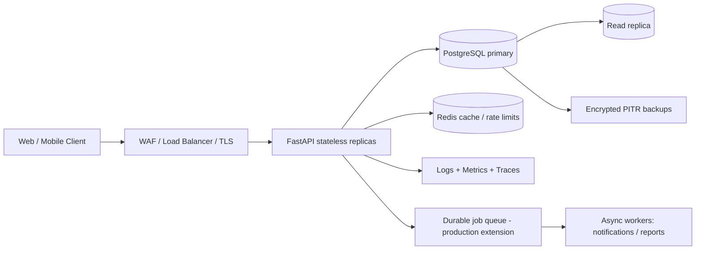
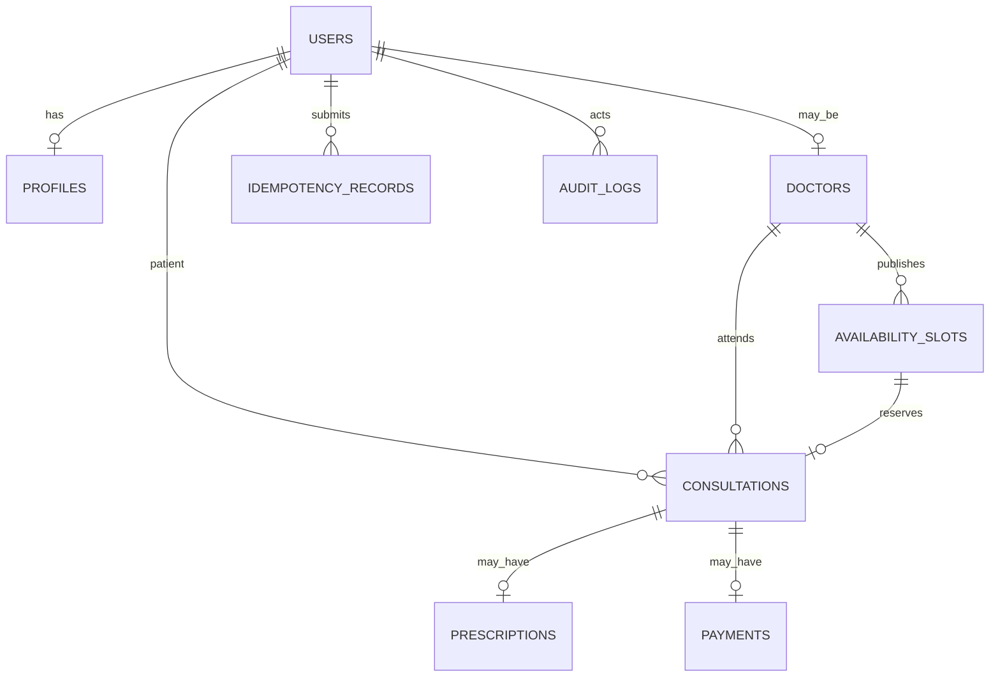

# Architecture — Amrutam Telemedicine Backend

## 1. Goals and assumptions
This reference implementation provides user registration/login, role-based access, doctor search, availability slots, consultation booking and status transitions, prescriptions, audit trails, and aggregate admin analytics. The target is 100,000 consultations/day (~1.16 consultations/sec average); design for bursts and regional peaks rather than average throughput alone. The p95 targets (<200 ms reads, <500 ms writes) and 99.95% availability are design objectives that require load testing and production deployment evidence; this local demo does not claim to prove them.

## 2. High-level architecture


The API is stateless; JWTs carry identity and role claims, while the database remains authoritative for active-user checks and object authorization. PostgreSQL owns booking consistency. Redis is an optimization and rate-limit counter, never the source of truth for slot availability. Sensitive health information is excluded from logs and metrics labels. A durable queue (for example, managed SQS/RabbitMQ) should handle email/SMS, payment webhooks, exports, and analytics.

## 3. Core data flow
Registration hashes the password with Argon2id, creates a user and profile in one transaction, and writes an audit event. Login verifies the hash and issues a short-lived signed access token. Admins create doctor accounts/profiles; doctors publish future timezone-aware slots. Patients search verified doctors and available slots, then book with an `Idempotency-Key`. Booking opens a database transaction, locks the selected slot `FOR UPDATE`, verifies availability, marks it unavailable, creates the consultation and idempotency record, and writes an audit event before commit. The unique constraint on `consultations.slot_id` is a second line of defense against double booking.

## 4. Booking sequence
```mermaid
sequenceDiagram
  participant P as Patient
  participant A as FastAPI
  participant D as PostgreSQL
  P->>A: POST /consultations + Idempotency-Key
  A->>D: Find existing idempotency record
  alt Same key and same request
    D-->>A: Stored response
    A-->>P: Replay prior response
  else New request
    A->>D: BEGIN; SELECT slot FOR UPDATE
    A->>D: Check available + verified doctor
    A->>D: Mark unavailable; insert consultation + audit + idempotency
    A->>D: COMMIT
    A-->>P: 201 Consultation
  end
```

## 5. ER model


## 6. API contract
OpenAPI is generated at `/openapi.json`; Swagger UI is `/docs`.
- `POST /auth/register`, `POST /auth/login`, `GET /users/me`
- `GET /doctors?specialty=&verified_only=&limit=&offset=`
- `POST /admin/doctors`
- `POST /doctors/{doctor_id}/slots`, `GET /doctors/{doctor_id}/slots`
- `POST /consultations` (requires `Idempotency-Key`)
- `GET /consultations`, `PATCH /consultations/{id}/status`
- `POST /consultations/{id}/prescriptions`, `GET /consultations/{id}/prescription`
- `GET /admin/analytics`, `GET /admin/audit-logs`
- `GET /health/live`, `GET /health/ready`, `GET /metrics`

## 7. Scaling, caching, partitioning
At 100k consultations/day, the average write rate is modest, but peak traffic, search, notification fan-out, and reporting dominate. Run multiple stateless API replicas behind a load balancer. Add PostgreSQL connection pooling (PgBouncer), read replicas for doctor search and admin analytics, and query-plan/index monitoring. Cache verified doctor directory/search results with short TTLs and invalidation on doctor changes; never cache private medical records in shared cache by default. Redis rate-limit keys expire automatically. Start with indexes on user email, doctor specialty/verification, slot doctor/start/availability, consultation patient/created and doctor/status. Partition large audit and consultation tables by creation month only when measured table size and query patterns justify the operational complexity; use retention policies and keep foreign-key/uniqueness implications explicit.

## 8. Transactions, concurrency, retries and sagas
Booking and cancellation use database transactions; row-level locking plus unique constraints prevent concurrent double booking. Idempotency records make client retries safe for booking, returning the original response for identical requests and `409` for key reuse with a different payload. Retry only transient failures (connection resets, serialization failures, 429/503) using exponential backoff with full jitter, e.g. 100 ms, 200 ms, 400 ms, max 2 seconds and 3 attempts; never retry validation, authorization or ordinary 4xx responses. Payments and notification delivery are not implemented against a live provider here. In production, use an outbox table committed with consultation/payment state, then asynchronously publish events; payment initiation/confirmation should be a saga with idempotent provider webhooks, reconciliation, and compensating refunds/cancellations rather than a distributed database transaction.

## 9. Reliability, observability, backup and DR
Use `/health/live` for process liveness and `/health/ready` for database readiness. Prometheus tracks request count and latency; JSON logs include request ID, route, status and duration, never passwords, tokens, prescription details, or patient notes. Production should add OpenTelemetry traces, RED dashboards (rate, errors, duration), SLO alerts, error-budget review, and synthetic booking checks. Set database backups to encrypted point-in-time recovery with WAL archiving; recommended initial objectives: RPO <=5 minutes and RTO <=60 minutes, to be validated by restore drills. Keep encrypted daily snapshots in a separate account/region, test restoration quarterly, and document failover and DNS procedures. Redis is disposable for cache/rate limit and should not block recovery of core bookings.

## 10. Production hardening before real patient data
This repo is a take-home baseline, not a certified clinical platform. Before production: run Alembic migrations rather than `create_all`; enforce TLS at the edge and TLS to managed database/Redis; use a secret manager/KMS and rotation; implement MFA (TOTP/WebAuthn) for clinicians/admins; add refresh-token rotation/revocation; add field-level encryption for sensitive data and key access auditing; configure backups, restore drills, WAF, SIEM, penetration testing, consent/retention workflows, privacy notices and applicable Indian healthcare/data-protection requirements. Validate with load and chaos tests against the actual target deployment.
